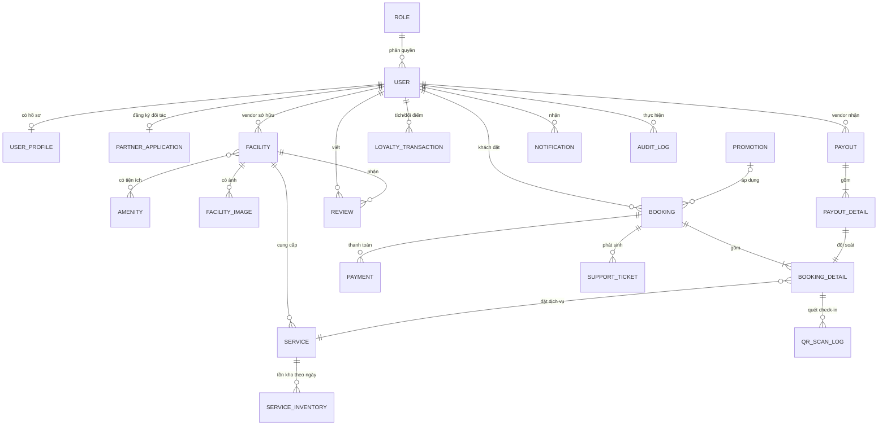
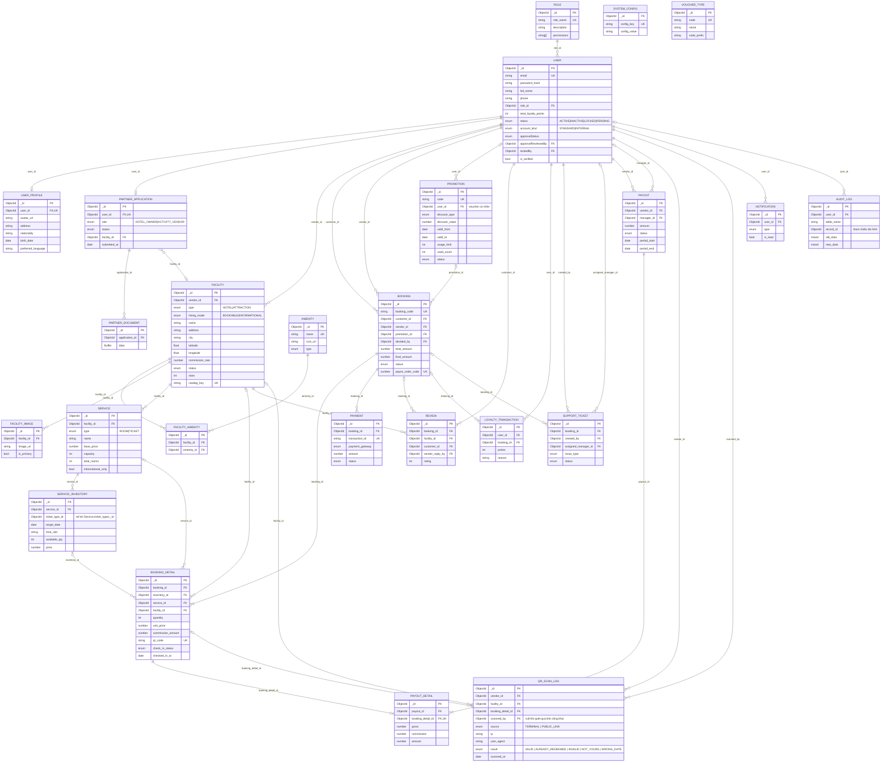

# Travelio – ERD & Database Design

> Nguồn đối chiếu: 23 Mongoose model trong `backend/src/models/` (nguồn chính xác nhất của code hiện tại).
> `init_schema.js` và `db/*.json` đã **lỗi thời** (xem mục 5). Chưa đối chiếu được với DB live trên Atlas (kết nối bị chặn quyền khi chạy) – xem mục 6.

## 0. ERD khác Database Design thế nào?

| | **ERD** | **Database Design** |
|---|---|---|
| Mục đích | Mô hình hoá *dữ liệu nghiệp vụ*: thực thể, thuộc tính, quan hệ | Quyết định *cách lưu trữ* trên một DBMS cụ thể |
| Độc lập công nghệ? | Có (conceptual/logical không phụ thuộc MongoDB/SQL) | Không – ở đây là MongoDB |
| Nội dung | Entity, PK, FK, quan hệ 1-1/1-N/N-N, chuẩn hoá 1NF–3NF | Collection, kiểu BSON, **embed vs reference**, index, unique/partial index, validator, denormalize có chủ đích |
| Câu hỏi trả lời | "Hệ thống có những gì và chúng liên quan thế nào?" | "Lưu thế nào để truy vấn nhanh, đúng, dễ bảo trì?" |

Tài liệu gồm: (1) ERD mức khái niệm, (2) ERD mức logic, (3) Database Design MongoDB, (4) chuẩn hoá, (5) sai lệch phát hiện được.

---

## 1. ERD mức khái niệm (Conceptual)

Chỉ thực thể chính + quan hệ tổng quát, chưa có thuộc tính.

---

## 2. ERD mức logic (Logical) – PK / FK / quan hệ

Mỗi bảng đều có `_id` (PK, ObjectId). Chỉ liệt kê các thuộc tính chính; field nhúng (embedded) ghi ở mục 3.

**Quan hệ N-N:** chỉ có `FACILITY ↔ AMENITY`, giải quyết bằng bảng trung gian `facility_amenities` (unique `(facility_id, amenity_id)`).
**Quan hệ 1-1:** `USER–USER_PROFILE`, `USER–PARTNER_APPLICATION`, `BOOKING_DETAIL–PAYOUT_DETAIL` (đều có unique index).
**Không có FK thật:** `AUDIT_LOG.record_id` (đa hình theo `table_name`), `Promotion.voucher_type` (string enum, không trỏ `voucher_types`), `ticket_type_id` (trỏ vào mảng nhúng).

---

## 3. Database Design (MongoDB)

### 3.1 Embed vs Reference

| Dữ liệu | Quyết định | Lý do |
|---|---|---|
| `Service.ticket_types[]` | **Embed** (subdoc có `_id`) | Luôn đọc cùng service, số lượng nhỏ |
| `Service.bedrooms[].beds[]`, `common_area_beds[]` | **Embed** | Thuộc tính mô tả phòng, không truy vấn riêng |
| `Booking.cancellation_requests[]` | **Embed** | Vòng đời gắn chặt booking |
| `PartnerApplication.documents[]` (metadata), `history[]` | **Embed** metadata; **file nhị phân tách** ra `partner_documents` | Tránh vượt 16MB & tránh load Buffer khi đọc hồ sơ |
| `Facility ↔ Amenity` | **Reference** qua bảng nối | N-N |
| `Booking → BookingDetail` | **Reference** (collection riêng) | Detail được truy vấn độc lập (check-in, đối soát payout, QR) |
| `Facility.promotions / check_in_policy`, `PartnerApplication.business/profile` | Embed dạng `Mixed` | Cấu trúc linh hoạt – đánh đổi: không có validate chặt |

### 3.2 Denormalization có chủ đích (snapshot)

| Field | Lý do |
|---|---|
| `BookingDetail.ticket_name/service_name/facility_name/unit_price/commission_rate/commission_amount/ticket_conditions` | Chụp lại giá/điều kiện tại thời điểm đặt; đổi giá về sau không làm sai đơn cũ |
| `PayoutDetail.booking_code/service_name/gross/commission/commission_rate` | Sổ đối soát bất biến, đọc nhanh không join |
| `User.total_loyalty_points` | Cache số dư; sự thật nằm ở tổng `loyalty_point_transactions.points` |

### 3.3 Index & ràng buộc quan trọng

| Collection | Index |
|---|---|
| users | `email` unique; `role_id` |
| user_profiles | `user_id` unique |
| partner_applications | `user_id` unique; `(status, submitted_at desc)` |
| facilities | `vendor_id`; `catalog_key` unique sparse; `city`; `(type,status)` |
| facility_amenities | `(facility_id, amenity_id)` unique; `amenity_id` |
| facility_images | `facility_id`; `(facility_id,is_primary)` unique partial (`is_primary:true`) → tối đa 1 ảnh chính |
| services | `facility_id`; `type` |
| service_inventory | `(service_id, ticket_type_id, target_date, time_slot)` unique; `target_date` |
| bookings | `booking_code` unique; `(customer_id, request_id)` unique partial (idempotency); `payos_order_code` unique partial; `(status, expires_at)`; `(status, created_at)` |
| booking_details | `booking_id`; `inventory_id`; `qr_code` unique sparse; `(service_id, check_in_date, check_out_date)` |
| payments | `transaction_id` unique; `booking_id`; `(status, payment_date)` |
| payout_details | `booking_detail_id` unique (1 dòng booking chỉ trả payout 1 lần); `payout_id` |
| payouts | `(vendor_id, period_start, period_end)`; `status` |
| reviews | `facility_id`; `customer_id` |
| loyalty_point_transactions | `(user_id, created_at desc)`; `booking_id` |
| support_tickets | `booking_id`; `created_by`; `assigned_manager_id`; `(status, created_at)` |
| notifications | `(user_id, created_at desc)`; `(user_id, is_read)` |
| audit_logs | `(user_id, created_at)`; `(table_name, record_id)`; `created_at` |
| qr_scan_logs | `(vendor_id, scanned_at)`; `(facility_id, scanned_at)` |
| promotions | `code` unique; `(status, valid_from, valid_to)`; `(points_cost, status)` |
| roles / amenities / system_configs / voucher_types | unique trên `role_name` / `name` / `config_key` / `code` |

### 3.4 Lưu ý thiết kế
- MongoDB **không enforce FK** – toàn vẹn tham chiếu do tầng ứng dụng đảm nhiệm.
- `reviews`: chưa có unique `(booking_id, customer_id)` – một booking có thể bị review nhiều lần nếu app không chặn.
- `Booking.vendor_id` chỉ có khi đơn thuộc một vendor (hiện là field tuỳ chọn).

---

## 4. Chuẩn hoá (Logical)

- **1NF:** đạt – mảng nhúng (`ticket_types`, `bedrooms`…) là giá trị có cấu trúc, có `_id` riêng; N-N đã tách ra bảng nối.
- **2NF/3NF:** các collection nghiệp vụ đạt (không phụ thuộc bắc cầu). Các vi phạm **chủ đích** (denormalize) chỉ ở mục 3.2 để đổi lấy snapshot lịch sử và hiệu năng đọc.
- **Chưa chuẩn:** `User` gộp nhiều nhóm OTP/khoá (`verification_otp_*`, `reset_otp_*`, `email_change_*`) – nên tách `user_security` nếu muốn gọn; `Promotion` dùng cả `target_audience`, `voucher_type`, `applicable_service` chồng chéo ngữ nghĩa.

---

## 5. Sai lệch phát hiện được (repo)

| Vấn đề | Chi tiết |
|---|---|
| `init_schema.js` lỗi thời | 21 collection; **thiếu** `partner_applications`, `partner_documents`, `qr_scan_logs`, `voucher_types`; `users.status` thiếu `PENDING`; thiếu các field mới (`approvalStatus`, `account_kind`, OTP…) |
| `db/*.json` | Chỉ là mô tả `collection/relationships/schema`, 21 file, không phải dữ liệu thật |
| Model `Role.permissions` | Có trong Mongoose, không có trong init_schema |

## 6. Phần chưa kiểm chứng
Tôi **chưa đối chiếu được với DB live** (`travelio_db` trên Atlas): lệnh kết nối bị chặn quyền. Nếu muốn, bạn cho phép chạy hoặc tự chạy script đọc (`listCollections`, `indexes`, lấy mẫu field) rồi gửi kết quả, tôi sẽ cập nhật mục "sai lệch".

> ⚠️ Chuỗi kết nối bạn dán có **mật khẩu thật**. Hãy đổi mật khẩu user Atlas đó và không commit/dán vào chat/tài liệu.

---

## 7. Entity Description

| # | Entity | Description |
|---|---|---|
| 1 | roles | Stores the predefined user roles within the system (e.g., admin, customer, vendor) and their descriptions to support Role-Based Access Control (RBAC). |
| 2 | users | Stores account information of all system actors, including credentials, contact details, role, status, loyalty point balance, and OTP/verification data used for authentication and account security. |
| 3 | user_profiles | Stores extended personal information of a user, such as avatar, address, nationality, date of birth, preferred language, and saved preferences, kept separate from the core account record. |
| 4 | partner_applications | Stores registration applications submitted by prospective hotel owners and activity vendors, including business information, uploaded document metadata, review status, and the approval history. |
| 5 | partner_documents | Stores the binary content of documents uploaded with a partner application (e.g., business licenses), separated from the application to keep application records lightweight. |
| 6 | facilities | Stores hotels and attractions listed on the platform, including location, description, star rating, commission rate, listing mode, and approval status, each owned by a vendor. |
| 7 | amenities | Stores the catalog of reusable amenities and features (e.g., Wi-Fi, pool, parking) with icons and categories that can be attached to facilities. |
| 8 | facility_amenities | Junction entity resolving the many-to-many relationship between facilities and amenities, recording which amenities each facility provides. |
| 9 | facility_images | Stores image URLs of a facility and marks the single primary image displayed as the cover photo. |
| 10 | services | Stores bookable or informational offerings of a facility: hotel rooms (capacity, bed configuration, total rooms) and attraction tickets (ticket types, age limits, pricing unit, duration). |
| 11 | service_inventory | Stores the daily and time-slot availability and price of a service or ticket type, used to control stock and prevent overbooking. |
| 12 | promotions | Stores discount vouchers and promotional codes, including discount type and value, validity period, usage limits, target audience, and the loyalty points required to redeem them. |
| 13 | voucher_types | Stores the catalog of voucher categories and their code prefixes used to classify and generate promotion codes. |
| 14 | bookings | Stores customer reservations, including guest contact details, applied promotion and points discount, total and final amount, payment-link data, status, and embedded cancellation/refund requests. |
| 15 | booking_details | Stores the individual line items of a booking (room stay or ticket), with a snapshot of price, commission, dates, quantity, QR code, and check-in status. |
| 16 | payments | Stores payment transactions of a booking, including gateway, transaction ID, amount, status, and reference information for reconciliation. |
| 17 | reviews | Stores customer ratings and comments for a facility, together with the vendor's reply. |
| 18 | loyalty_point_transactions | Stores the ledger of loyalty points earned or redeemed by users, with the reason and the related booking, serving as the source of truth for point balances. |
| 19 | support_tickets | Stores customer or vendor support requests (refund, facility issue, check-in error, etc.), their processing status, and the manager assigned to resolve them. |
| 20 | payouts | Stores payout requests and settlements paid to vendors for a period, including gross amount, commission, bank account, approval status, and payment reference. |
| 21 | payout_details | Stores the booking lines included in a payout, each with gross, commission and net amount, ensuring every booking line is settled only once. |
| 22 | qr_scan_logs | Stores the history of QR code scans performed at check-in, including the scanner, facility, and result (valid, already redeemed, invalid, not yours) for auditing and fraud detection. |
| 23 | notifications | Stores messages sent to users about system events, bookings, promotions, and ticket updates, with read/unread state. |
| 24 | audit_logs | Stores an immutable trail of data changes (actor, action, target record, old and new values) for traceability and security auditing. |
| 25 | system_configs | Stores global key–value configuration parameters of the system that administrators can adjust without code changes. |
