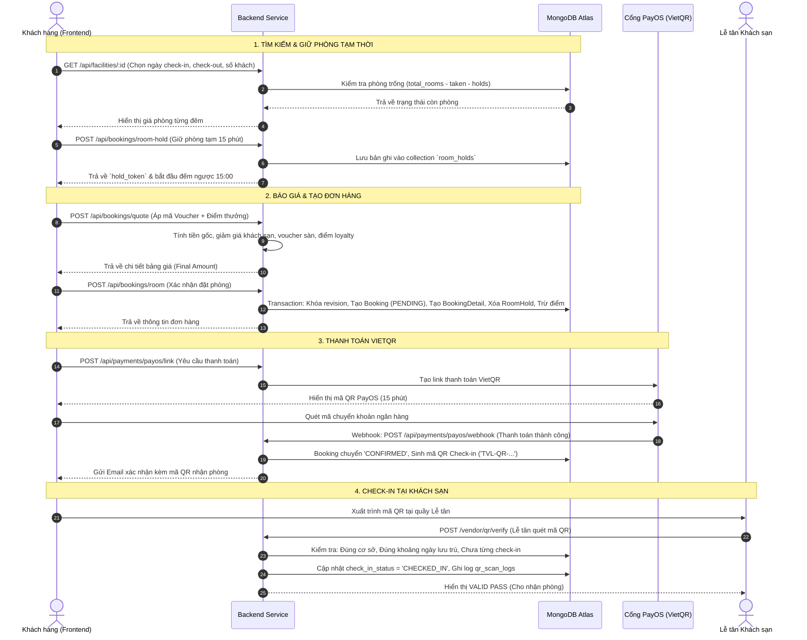

# Luồng Hoạt Động & Quy Tắc Nghiệp Vụ Phân Hệ Booking (Travelio)

Tài liệu này mô tả chi tiết, toàn diện kiến trúc kỹ thuật, luồng dữ liệu (Workflow) và các quy tắc nghiệp vụ (Business Rules) của phân hệ **Đặt phòng khách sạn (Hotel Booking)** và **Đặt vé tham quan/vui chơi (Attraction Ticket Booking)** trong dự án Travelio.

---

## 1. Kiến trúc Bảng Dữ liệu Cốt lõi (Database Models)

Hệ thống quản lý đặt chỗ thông qua các collection chính trong MongoDB:

| Collection | Model tương ứng | Vai trò và các trường dữ liệu then chốt |
| :--- | :--- | :--- |
| **`bookings`** | `Booking.js` | Quản lý đơn hàng tổng: • `booking_code`: Mã đơn định danh duy nhất (dạng `TVL-XXXXXXXX`). • `customer_id`, `vendor_id`: Người đặt và đối tác tiếp nhận. • `status`: `PENDING` ➔ `CONFIRMED` ➔ `COMPLETED` (hoặc `CANCELLED`, `REFUNDED`). • `total_amount`, `final_amount`: Tiền gốc và tiền thực trả sau chiết khấu. • `expires_at`: Thời hạn hết hạn thanh toán (mặc định 15 phút). |
| **`booking_details`** | `BookingDetail.js` | Quản lý chi tiết từng phòng hoặc từng hạng vé trong đơn: • `service_id`, `facility_id`: Hạng phòng/loại vé và cơ sở du lịch. • `check_in_date`, `check_out_date`, `nights`: Khoảng ngày lưu trú (với khách sạn). • `visit_date`, `time_slot`: Ngày và khung giờ sử dụng (với vé tham quan). • `quantity`, `unit_price`, `commission_rate`: Số lượng, đơn giá và tỷ lệ hoa hồng sàn. • `qr_code`: Chuỗi token QR phục vụ check-in (dạng `TVL-QR-...`). • `check_in_status`: `PENDING` ➔ `CHECKED_IN` (hoặc `NO_SHOW`). • `checked_in_at`: Thời gian thực tế khách nhận phòng/qua cổng. |
| **`room_holds`** | `RoomHold.js` | Quản lý khóa giữ phòng tạm thời 15 phút chống Overbooking: • `hold_token`: Mã token giữ chỗ từ client. • `service_id`, `rooms`, `check_in_date`, `check_out_date`, `expires_at`. |
| **`service_inventory`**| `ServiceInventory.js` | Quản lý kho vé và số lượng mở bán giới hạn theo từng ngày/suất tham quan. |
| **`payments`** | `Payment.js` | Nhật ký giao dịch cổng PayOS (`booking_id`, `amount`, `status`, `reference_code`). |
| **`qr_scan_logs`** | `QrScanLog.js` | Nhật ký quét mã QR check-in (`qr_code`, `scanned_by`, `result`, `ip`, `user_agent`). |

---

## 2. Luồng & Nghiệp vụ Booking Khách Sạn (Hotel Booking Lifecycle)

---

### Chi tiết nghiệp vụ từng giai đoạn:

### Giai đoạn 1: Kiểm tra phòng trống & Lịch bán (Availability Check)
* **File phụ trách**: `backend/src/services/facility.service.js` (`getRoomAvailability`, `getRoomCalendarAvailability`).
* **Thuật toán cốt lõi**:
  - Hạng phòng có tổng số phòng sẵn có là `service.total_rooms`.
  - Một phòng bị coi là đang bị chiếm trong khoảng ngày `[check_in, check_out)` nếu thỏa mãn điều kiện thời gian giao thoa:
    $$\text{check\_in\_date} < \text{checkOut} \quad \text{VÀ} \quad \text{check\_out\_date} > \text{checkIn}$$
  - **Công thức đếm số phòng bị chiếm thực tế:**
    $$\text{Phòng bị chiếm} = \text{Phòng CONFIRMED} + \text{Phòng PENDING (còn hạn)} + \text{Phòng đang giữ (RoomHold của người khác)}$$
  - Nếu: $\text{Phòng bị chiếm} + \text{Số phòng khách chọn} > \text{total_rooms} \rightarrow$ Báo lỗi *"Loại phòng này đã hết phòng trong ngày bạn chọn"*.

### Giai đoạn 2: Cơ chế Giữ phòng tạm thời (`RoomHold` - 15 phút)
* **File phụ trách**: `backend/src/services/booking.service.js` (hàm `holdRoom`).
* **API Endpoint**: `POST /api/bookings/room-hold` & `DELETE /api/bookings/room-hold`.
* **Nghiệp vụ**:
  - Khi khách bấm vào màn hình Checkout, hệ thống tạo một token giữ phòng có hạn chót 15 phút (`expires_at = now + 15 phút`).
  - Trong 15 phút này, người khác tìm phòng sẽ thấy phòng đã bị tạm giữ, loại bỏ hoàn toàn việc 2 người cùng thanh toán tranh nhau 1 phòng cuối cùng (Overbooking).
  - Nếu khách bấm hủy hoặc thoát trang thanh toán, client gọi `DELETE` để nhả phòng ngay lập tức.

### Giai đoạn 3: Báo giá & Khuyến mãi (`quoteBooking`)
* **File phụ trách**: `backend/src/services/booking.service.js` (hàm `quoteBooking`).
* **API Endpoint**: `POST /api/bookings/quote`.
* **Quy tắc tính tiền 5 bước**:
  1. $\text{Tiền phòng gốc} = \text{Đơn giá phòng/đêm} \times \text{Số đêm} \times \text{Số phòng}$.
  2. **Khuyến mãi khách sạn (`calculateHotelPromotion`)**: Áp dụng nếu khách đặt dài ngày (ví dụ ở từ 3 đêm giảm 5%).
  3. **Mã Voucher sàn Travelio (`calculateDiscounts`)**: Kiểm tra mã còn hạn, đúng loại `HOTEL` hoặc `ALL`, đạt giá trị đơn tối thiểu (`min_order_amount`), tính giảm theo % (áp mức giảm tối đa `max_discount`) hoặc giảm cố định (`FIXED`).
  4. **Điểm thưởng thành viên**: 1 điểm = 1.000 VNĐ, trừ thẳng vào tiền thanh toán.
  5. **Hoa hồng sàn**: Ghi nhận hoa hồng theo cơ sở (`commission_rate`) hoặc mặc định toàn sàn 12%.

### Giai đoạn 4: Tạo đơn đặt phòng (`createRoomBooking`)
* **File phụ trách**: `backend/src/services/booking.service.js` (hàm `createRoomBooking`).
* **API Endpoint**: `POST /api/bookings/room`.
* **Nghiệp vụ trong MongoDB Transaction**:
  - Kiểm tra sức chứa: `guests <= (service.capacity || 2) * rooms`.
  - Khóa phân tán lạc quan (Optimistic Concurrency Control) bằng trường `booking_revision`: tăng revision để tránh xung đột ghi đè đồng thời.
  - Tạo `Booking`: mã dạng `TVL-XXXXXXXX`, `status = 'PENDING'`, `expires_at = now + 15 phút`.
  - Tạo `BookingDetail`: Lưu `check_in_date`, `check_out_date`, `nights`, số lượng phòng.
  - Trừ điểm thưởng thành viên trong ví của khách (nếu có dùng điểm).
  - Xóa bản ghi `RoomHold`.

### Giai đoạn 5: Thanh toán trực tuyến (PayOS VietQR)
* **File phụ trách**: `backend/src/services/payment.service.js`.
* **Webhook Endpoint**: `POST /api/payments/payos/webhook`.
* **Nghiệp vụ**:
  - Sinh mã thanh toán VietQR với nội dung chuẩn hóa: `TVL <8 ký tự cuối mã booking>`.
  - Khi khách chuyển khoản thành công, PayOS gọi Webhook về backend.
  - Backend kiểm tra chữ ký số HMAC-SHA256:
    - Chuyển `Booking.status` từ `PENDING` $\rightarrow$ **`CONFIRMED`**.
    - **Sinh mã QR Check-in**: `qr_code = 'TVL-QR-' + crypto.randomBytes(12).toString('hex').toUpperCase()`.
    - Gửi email xác nhận đặt phòng kèm hóa đơn và mã QR cho khách.

### Giai đoạn 6: Check-in tại quầy Lễ tân Khách sạn
* **File phụ trách**: `backend/src/services/checkin.service.js` & `backend/src/services/vendor.service.js` (hàm `verifyQr`).
* **Giao diện**: Trang QR Terminal của Lễ tân (`/vendor/qr-terminal`).
* **Nghiệp vụ xác thực**:
  - Khách xuất trình mã QR từ trang "Chuyến đi của tôi" (`/my-trips`).
  - Lễ tân quét mã QR $\rightarrow$ Backend kiểm tra:
    - Đúng cơ sở quản lý (`facility_id`).
    - Đúng khoảng ngày lưu trú (`check_in_date <= today <= check_out_date`).
    - Trạng thái chưa check-in (`check_in_status === 'PENDING'`).
  - Hợp lệ: Cập nhật `check_in_status = 'CHECKED_IN'`, lưu `checked_in_at = now()`, ghi vết `qr_scan_logs`.
  - **Chống gian lận (Anti-Fraud)**: Nếu quét lại mã lần thứ 2, hệ thống lập tức từ chối và cảnh báo **`ALREADY_REDEEMED`** (Mã đã được sử dụng trước đó).
* **Quản lý khách vắng mặt (No-Show Panel)**:
  - Giờ check-in tiêu chuẩn là **14:00**.
  - Sau 14:00 + 2 tiếng ân hạn (`NO_SHOW_GRACE_MS = 2 giờ`), tức sau **16:00**:
    Nếu phòng vẫn chưa check-in, hệ thống tự động đưa khách vào danh sách **No-Show Panel** kèm Tên và SĐT để lễ tân gọi điện hỗ trợ.

### Giai đoạn 7: Hoàn tất kỳ nghỉ & Đối soát doanh thu
* **File phụ trách**: `backend/src/services/booking.service.js` (hàm `completeFinishedBookings`).
* **Nghiệp vụ**:
  - Cron job chạy định kỳ: Khi đã qua ngày trả phòng (`check_out_date < today`), hệ thống tự động:
    - Chuyển `Booking.status` sang **`COMPLETED`**.
    - **Tích điểm thưởng**: Tự động cộng điểm Loyalty mới cho khách (1% giá trị đơn hàng).
    - **Đối soát (Settlement)**: Chốt số tiền thực nhận của Khách sạn:
      $$\text{Thực nhận (Net)} = \text{Tổng tiền khách thanh toán} - \text{Hoa hồng sàn (12%)}$$
      Khách sạn có thể tạo lệnh rút tiền (Payout) về tài khoản ngân hàng tại trang `/vendor/settlements`.

---

## 3. Luồng & Nghiệp vụ Booking Vé Tham Quan (Attraction Ticket Lifecycle)

### Điểm khác biệt cốt lõi so với Khách sạn:
1. **Thời gian sử dụng**:
   - Khách sạn tính theo **khoảng ngày lưu trú và số đêm ở** (`check_in_date`, `check_out_date`, `nights`).
   - Vé tham quan gắn liền với **ngày đi cụ thể (`visit_date`)** và **khung giờ (`time_slot`: Sáng, Chiều, Cả ngày `ALL_DAY`)**.
2. **Quản lý Hạn mức bán vé (`ServiceInventory`)**:
   - Vé có thể được giới hạn số lượng mở bán theo từng ngày trong bảng `service_inventory`. Hệ thống kiểm tra số vé còn lại trước khi cho phép đặt.
3. **Mã Vé điện tử (E-ticket QR Code)**:
   - Mỗi hạng vé (Người lớn, Trẻ em, VIP) được cấp mã QR độc lập.
4. **Soát vé tại Cổng vào (`/checkin/:code`)**:
   - Khách mang mã QR đến cổng khu du lịch.
   - Nhân viên dùng điện thoại/máy quét kiểm tra: Đúng điểm tham quan, Đúng ngày tham quan $\rightarrow$ Bấm xác nhận vào cổng ➔ Vé chuyển sang trạng thái **`USED`** (`check_in_status = 'CHECKED_IN'`).
   - Quét lại lần 2 từ chối ngay lập tức để chống vé quay đầu.

---

## 4. Quy trình Hủy Đơn & Hoàn Tiền (Cancellation Policy)

* **File phụ trách**: `backend/src/services/booking.service.js` (`calculateCancellationPolicy`, `requestCancellation`, `decideCancellation`).
* **Chính sách hoàn tiền tự động theo mốc thời gian**:
  - Hủy trước giờ Check-in $\ge 48$ tiếng: **Hoàn 100% tiền**.
  - Hủy trước từ $24 - 48$ tiếng: **Hoàn 50% tiền**.
  - Hủy trong vòng 24 tiếng trước giờ nhận phòng: **Không hoàn tiền (0%)**.
* **Quy trình xử lý**:
  1. Khách bấm *Yêu cầu hủy đặt chỗ* trên web (`/my-trips`). Đơn chuyển trạng thái `CANCELLATION_REQUESTED`.
  2. Chủ khách sạn hoặc Quản lý sàn (`Manager`) kiểm tra lý do tại trang `/admin/approvals`.
  3. Bấm **Duyệt hủy (Approve)** ➔ Hệ thống tự động:
     - Chuyển trạng thái đơn sang `CANCELLED` / `REFUNDED`.
     - **Nhả phòng/vé về kho ngay lập tức** để người khác có thể đặt.
     - **Hoàn trả 100% điểm thưởng thành viên** nếu khách đã dùng điểm khi đặt đơn này.

---

## 5. Tự động Hủy Đơn Treo Quá Hạn 15 Phút (`expireStaleBookings`)

* **File phụ trách**: `backend/src/services/booking.service.js` (hàm `expireStaleBookings`).
* **Nghiệp vụ**:
  - Nếu khách tạo đơn nhưng quá 15 phút không thanh toán PayOS (`status === 'PENDING'` và `expires_at < now`):
    - Tự động hủy đơn (`status = 'CANCELLED'`).
    - Nhả toàn bộ phòng trong `room_holds` và nhả vé trong `service_inventory`.
    - Tự động hoàn lại điểm thưởng loyalty đã bị tạm trừ lúc tạo đơn.

---

## 6. Bảng Tổng Hợp Trạng Thái Đơn Hàng trong Database

| Trạng thái (`status`) | Ý nghĩa nghiệp vụ | Hành động tiếp theo |
| :--- | :--- | :--- |
| **`PENDING`** | Khách vừa tạo đơn, đang giữ chỗ, chờ thanh toán PayOS trong 15 phút. | Chờ Webhook thanh toán thành công hoặc quá 15 phút tự động hủy. |
| **`CONFIRMED`** | Đã thanh toán thành công, có hiệu lực sử dụng, đã cấp mã QR nhận phòng/vé. | Chờ khách đến nhận phòng hoặc quét mã vào cổng. |
| **`COMPLETED`** | Khách đã hoàn tất kỳ nghỉ (qua ngày check-out) hoặc đã dùng vé. | Chốt doanh thu đối soát chuyển cho Vendor. Khách được tích điểm thưởng và viết nhận xét. |
| **`CANCELLED`** | Đơn bị hủy do quá hạn 15 phút hoặc do yêu cầu hủy được phê duyệt. | Nhả phòng/vé về kho bán, hoàn lại điểm thưởng (nếu có). |
| **`REFUNDED`** | Đơn hủy đã được duyệt và xử lý hoàn tiền thành công theo tỷ lệ chính sách. | Ghi nhận giao dịch hoàn tiền, cập nhật trạng thái kết toán. |
