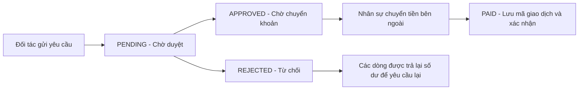
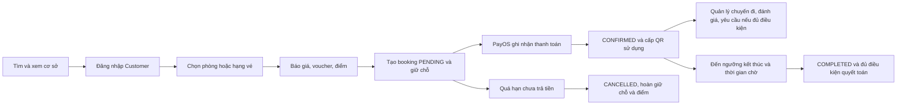

# Travelio — Bản đồ tính năng và nghiệp vụ theo vai trò

Ngày rà soát: **27/10/2026**. Tài liệu mô tả mã nguồn đang có trong workspace tại thời điểm rà soát, gồm cả quyết toán đối tác và Business Performance mới được bổ sung.

Mục tiêu: giúp thành viên nhóm biết người dùng nào có thể làm gì, đi qua màn hình nào, hệ thống xử lý ra sao và phần nào còn chưa hoàn thiện.

## 1. Phạm vi và cách đọc

Đã đối chiếu frontend routes, các trang và component xử lý nghiệp vụ, API client, backend routes/controllers/services, models, middleware phân quyền, tác vụ nền, tài liệu và các bộ test liên quan. Không tính thư viện `node_modules`, mã build hay dữ liệu seed là tính năng người dùng. File tồn tại nhưng chưa được nối vào luồng chạy không được coi là một màn hình đã triển khai.

Đây là **bản rà soát mã nguồn**, không phải xác nhận mọi chức năng đã chạy thành công với database, SMTP, Cloudinary, PayOS và tài khoản ngân hàng đang vận hành. Phiên rà soát này không thực hiện giao dịch thật, gửi email hoặc thay đổi dữ liệu nghiệp vụ.

Quy ước:

| Nhãn | Ý nghĩa |
| --- | --- |
| Có luồng triển khai | Có giao diện/điểm vào, API và xử lý backend tương ứng trong nguồn hiện tại. Vẫn có thể có giới hạn ghi kèm. |
| Có giới hạn | Luồng có xử lý thật nhưng phạm vi chưa đầy đủ hoặc có điểm chưa khớp cần lưu ý. |
| Giao diện mô phỏng | Có màn hình/thao tác nhưng chưa có lưu hoặc truy vấn nghiệp vụ thật cho thao tác đó. |
| API riêng | Backend có khả năng xử lý nhưng chưa có màn hình quản trị tương ứng trong routes hiện tại. |
| Chưa thấy triển khai | Chưa thấy luồng sử dụng tương ứng; có model hoặc câu chữ giới thiệu không đủ để xác nhận đã làm. |

## 2. Các vai trò và khu vực sử dụng

| Vai trò/trạng thái | Vai trò nghiệp vụ | Khu vực chính |
| --- | --- | --- |
| Khách chưa đăng nhập | Tìm và xem dịch vụ, bắt đầu đăng ký | `/`, `/search`, `/facilities/:id`, `/auth/:mode` |
| `CUSTOMER` | Khách đặt phòng/mua vé | Khu khách hàng, `/checkout`, `/my-trips`, `/profile` |
| Người đang nộp hồ sơ đối tác | Customer đang xin quyền kinh doanh; đây là trạng thái hồ sơ, không phải role riêng | `/partner/register/hotel`, `/partner/register/attraction`, `/partner/registration-pending` |
| `HOTEL_OWNER` | Đối tác cung cấp phòng nghỉ | `/vendor` và các trang quản lý lưu trú |
| `ACTIVITY_VENDOR` | Đối tác cung cấp vé, tour và trải nghiệm | `/vendor` và các trang quản lý cơ sở/dịch vụ/vé |
| `MANAGER` | Nhân sự vận hành được phân quyền | `/admin` và các module được cấp quyền |
| `ADMIN` | Quản trị hệ thống và phân quyền | Toàn bộ module quản trị theo cấu hình quyền |

Mỗi tài khoản hiện tham chiếu **một role**. Quyền quản trị có thể chỉnh ở cấp role, không có màn hình cấp quyền riêng từng tài khoản. Admin/Manager được đưa về `/admin`; hai loại đối tác về `/vendor`; Customer về `/` sau đăng nhập.

API tạo booking và đọc My Trips yêu cầu đúng role CUSTOMER. Vì vậy tài khoản đã được chuyển sang role đối tác không đồng thời tiếp tục đặt/xem đơn theo quyền Customer bằng chính tài khoản đó; chưa có cơ chế chuyển chế độ khách/đối tác trong một tài khoản đa vai trò.

Khu admin được chặn theo đúng role ADMIN/MANAGER. Khu vendor được chặn theo đúng role HOTEL_OWNER/ACTIVITY_VENDOR. Có quyền trong danh sách vẫn phải thỏa những điều kiện role riêng của từng API.

## 3. Khách chưa đăng nhập

### 3.1. Tìm kiếm và khám phá

| Chức năng | Cách sử dụng và kết quả |
| --- | --- |
| Trang chủ | Xem danh sách khách sạn và hoạt động nổi bật lấy từ API, chọn nhóm lưu trú hoặc tham quan để tìm kiếm. Một số nội dung quảng bá/danh mục địa điểm là dữ liệu hiển thị cố định. |
| Gợi ý điểm đến | Nhập địa danh/tên cơ sở; có tìm kiếm không dấu, gợi ý địa điểm phổ biến và cơ sở từ database. |
| Tìm cơ sở | Tìm theo từ khóa, tên, địa chỉ, thành phố; chọn loại khách sạn hoặc tham quan. |
| Bộ lọc | Khoảng giá, số sao, điểm đánh giá tối thiểu, tiện ích, số phòng, số khách và ngày đi/ngày ở. |
| Sắp xếp | Giá tăng/giảm, đánh giá, mới nhất hoặc gợi ý. |
| Phân trang | API trả danh sách theo trang, mặc định 10 kết quả/trang. |
| Xem chi tiết | Xem tên, địa chỉ, mô tả, hình ảnh, tiện nghi, phòng/dịch vụ, giá và đánh giá/phản hồi. |
| Xem ảnh | Mở bộ ảnh, chuyển ảnh và xem thông tin phòng/dịch vụ chi tiết. |
| Xem vị trí | Có hiển thị/liên kết vị trí và chỉ đường qua bản đồ tùy màn hình. |
| Xem vé khả dụng | Với hoạt động, chọn ngày để xem các hạng vé, lịch bán, khung giờ, số còn và giá tương ứng. |

**Giới hạn tìm phòng:** bộ lọc ngày/số khách dùng để tính giá dự kiến và kiểm tra sức chứa/tổng phòng cấu hình. Pipeline tìm kiếm chưa trừ các booking trùng ngày để bảo đảm kết quả tìm kiếm còn phòng. Backend kiểm tra tồn phòng thực tế khi tạo booking.

### 3.2. Đăng ký và đăng nhập

- Customer có thể đăng ký họ tên, email, mật khẩu, xác nhận mật khẩu và chấp nhận điều khoản trên form.
- Đăng ký mới cần OTP email; chưa xác minh thì chưa đăng nhập được.
- Có đăng nhập bằng email/mật khẩu, đăng xuất, quên mật khẩu qua OTP và đặt mật khẩu mới.
- Có chọn bắt đầu đăng ký đối tác khách sạn hoặc nhà cung cấp hoạt động.
- Đặt dịch vụ cần đăng nhập Customer; hệ thống có điều hướng sang đăng nhập để tiếp tục luồng.

### 3.3. Những phần khách thấy nhưng chưa phải nghiệp vụ thật

- Widget **“Tra cứu đơn đặt chỗ & vé QR — Không cần tài khoản”** trên trang chủ chỉ xét độ dài chuỗi nhập để hiện thông báo tìm thấy/không tìm thấy. Chưa có API tra cứu đơn khách vãng lai bằng mã/email. Bấm xem tiếp đi đến My Trips, nơi cần đăng nhập.
- Trang giới thiệu, trợ giúp/chính sách ở footer chưa có một hệ thống CMS/hỗ trợ riêng tương ứng trong routes đã đọc.
- Chưa thấy luồng đặt vé máy bay, thuê xe, đăng nhập mạng xã hội hoặc danh sách yêu thích lưu trên server.

## 4. CUSTOMER — Khách hàng

Customer sử dụng được các chức năng công khai ở trên và các nghiệp vụ bên dưới.

### 4.1. Hồ sơ và bảo mật

Màn hình: `/profile`.

| Chức năng | Kết quả |
| --- | --- |
| Xem hồ sơ | Xem tên, email, SĐT, role, trạng thái và số điểm. |
| Sửa thông tin | Lưu họ tên, SĐT và địa chỉ. |
| Ảnh đại diện | Upload/thay/xóa avatar qua Cloudinary; cần cấu hình dịch vụ. |
| Đổi email | Gửi OTP đến email mới; chỉ thay email sau khi xác minh thành công. |
| Đổi mật khẩu | Nhập đúng mật khẩu hiện tại, mật khẩu mới tối thiểu 8 ký tự và khác mật khẩu cũ. |
| Điểm và ưu đãi | Xem số dư điểm, voucher có thể đổi, voucher của mình và lịch sử điểm. |

OTP đăng ký/quên mật khẩu hết hạn sau 5 phút, tối đa 5 lần nhập/mã; gửi lại cách ít nhất 60 giây và tối đa 5 lần/giờ theo tài khoản/mục đích. Token hoàn tất đặt lại mật khẩu có hạn 10 phút và dùng một lần. Đổi email cũng có giới hạn gửi/nhập OTP riêng.

Quản lý phương thức thanh toán đã lưu không thuộc phạm vi triển khai; mục này đã được bỏ khỏi trang hồ sơ. Thanh toán booking bằng PayOS là luồng riêng.

### 4.2. Đặt phòng khách sạn

Luồng: **Tìm khách sạn → xem chi tiết → chọn loại phòng, ngày nhận/trả, số phòng và số khách → Checkout → tạo booking → thanh toán → xem đơn**.

Tại checkout có thể nhập thông tin liên hệ, chọn mã ưu đãi và dùng điểm đang có để giảm giá. Backend tự tính lại báo giá; không tin giá gửi từ giao diện.

Các quy tắc hiện có:

- Ngày nhận phòng không được ở quá khứ; thời gian ở từ 1 đến 30 đêm.
- Mỗi đơn tạo từ 1 đến 20 phòng; số khách được kiểm tra theo sức chứa của loại phòng và số phòng.
- Tiền gốc = giá cơ bản loại phòng × số đêm × số phòng.
- Kiểm tra các booking PENDING/CONFIRMED trùng khoảng lưu trú để tránh vượt tổng phòng; có xử lý giao dịch đồng thời.
- Tạo booking trạng thái PENDING với thời hạn giữ chỗ 15 phút; request lặp cùng mã yêu cầu không tạo thêm đơn mới.
- Lưu thông tin phòng, số lượng, giá, ngày nhận/trả, số đêm, giảm giá, điểm đã dùng và tỷ lệ hoa hồng vào dữ liệu booking.

**Giới hạn:** các ô “đặt hộ”, giờ đến dự kiến và ghi chú trên form checkout chưa được lưu đầy đủ xuống model/booking payload. Số khách có kiểm tra khi tạo đơn nhưng chưa được lưu thành trường guest count riêng cho biên nhận. Không nên coi mọi ô trên form là thông tin đã lưu.

### 4.3. Mua vé, tour và trải nghiệm

Luồng: **Xem điểm/dịch vụ → chọn ngày → chọn dịch vụ và hạng vé → chọn lịch/khung giờ nếu có → chọn số lượng → Checkout → tạo booking → thanh toán**.

- Có một dịch vụ với nhiều hạng vé, ví dụ người lớn/trẻ em, hạng vé có giá 0, điều kiện và giới hạn tuổi.
- Có mô tả, địa điểm, ảnh, thời lượng, đơn vị tính giá và các thông tin điều kiện sử dụng.
- Hạng vé chưa có lịch bán riêng có thể bán trực tiếp theo giá hạng vé.
- Hạng vé đã cấu hình lịch phải chọn lịch bán đang tồn tại; không được bỏ qua hạn mức bằng cách mua trực tiếp.
- Giá lịch bán có thể kế thừa giá hạng vé hoặc là giá riêng cho ngày/khung giờ.
- Lịch có hạn mức được trừ tồn kho khi tạo đơn; nếu vừa hết vé hoặc giá thay đổi thì hệ thống báo để khách chọn lại.
- Một booking vé mới chỉ chứa dịch vụ của **một Vendor**. Dữ liệu đơn nhiều đối tác cũ vẫn có xử lý đọc/phân bổ ở các module báo cáo.
- Chi tiết vé, giá và điều kiện được lưu cùng booking để giữ thông tin lúc mua.

### 4.4. Thanh toán booking

Màn hình thanh toán nằm trong `/my-trips/:id`, dùng PayOS.

Khách có thể xem QR thanh toán ngân hàng, ngân hàng/BIN, tài khoản nhận, tên chủ tài khoản nếu có, số tiền, nội dung chuyển khoản và mở trang thanh toán PayOS. Trang kiểm tra trạng thái định kỳ để tự cập nhật kết quả.

Backend hỏi PayOS để đối soát. Khi ghi nhận thanh toán phù hợp, hệ thống lưu Payment, chuyển booking từ PENDING sang CONFIRMED và cấp mã QR sử dụng cho các dòng chưa có mã. Mã giao dịch có khóa chống lưu trùng.

Tác vụ nền kiểm tra đơn chưa thanh toán mỗi 10 giây; trang thanh toán hỏi lại khoảng 3 giây/lần. Booking quá hạn được kiểm tra lại thanh toán trước khi tự hủy; khi hủy vì hết hạn sẽ trả tồn kho vé, hoàn điểm đã dùng và giảm lượt dùng voucher tương ứng.

**Giới hạn:** chưa có webhook trong source hiện tại. Thanh toán dùng PayOS cần các khóa cấu hình. Logic ghi nhận hiện tại đánh dấu khoản chuyển thiếu là FAILED, chưa phải một luồng gom nhiều khoản chuyển thiếu hoàn chỉnh cho khách; báo cáo có hỗ trợ đọc lịch sử nhiều Payment nên không đồng nghĩa màn thanh toán đã hỗ trợ mọi hình thức trả góp/chia lần.

### 4.5. Quản lý chuyến đi và biên nhận

Màn hình: `/my-trips`, `/my-trips/:id`.

- Xem đơn của chính mình, không xem được đơn tài khoản khác qua API Customer.
- Chia tab Sắp tới, Đã hoàn thành và Đã hủy. Đơn chờ thanh toán vẫn truy cập được ở Sắp tới; các đơn khác có nhóm riêng.
- Sắp tới dựa trên đơn xác nhận và ngày dịch vụ/nhận phòng từ hôm nay trở đi theo giờ Việt Nam. Qua ngày không tự được xem là hoàn tất chỉ bởi frontend.
- Xem mã đơn, thông tin liên hệ khách, phòng/vé, số lượng, ngày sử dụng, các khoản giảm, tổng tiền và các Payment đã lưu.
- Xem tiến trình đơn, trạng thái thanh toán, lịch sử yêu cầu hủy/đổi/hoàn và phản hồi của đối tác.
- Xem QR sử dụng khi đơn đã xác nhận và dòng dịch vụ chưa được sử dụng. Mã thanh toán ngân hàng và mã sử dụng dịch vụ là hai loại riêng.
- In/lưu PDF biên nhận qua hộp thoại in của trình duyệt. Đây là biên nhận booking, chưa phải hóa đơn thuế điện tử.
- Danh sách hiện lấy tối đa 100 booking mới nhất; chưa có phân trang toàn bộ lịch sử Customer. Đơn cũ có thể mở qua URL chi tiết nếu còn quyền sở hữu.

### 4.6. Hủy, đổi ngày và hoàn tiền

Khách có thể gửi yêu cầu kèm lý do, xem trạng thái chờ/chấp thuận/từ chối và lịch sử xử lý. Mỗi đơn chỉ có một yêu cầu đang chờ tại một thời điểm; tối đa 50 yêu cầu lưu trên đơn.

Phạm vi khác nhau giữa hai loại dịch vụ:

| Loại đơn | Điều kiện hiện có |
| --- | --- |
| Vé/hoạt động | Yêu cầu được cho đơn PENDING chưa có Payment, chưa dùng điểm, chưa cấp mã QR; đơn thuộc một đối tác. Vé đã thanh toán không có luồng hoàn/hủy đầy đủ qua cơ chế này. |
| Phòng nghỉ | Có thể yêu cầu với đơn PENDING/CONFIRMED chưa check-in, cùng một đối tác và chưa có yêu cầu đang chờ. |
| Đơn hỗn hợp phòng/vé hoặc nhiều đối tác | Không được xử lý toàn đơn bằng luồng yêu cầu hiện tại. |

Đối tác có thể duyệt/từ chối. Duyệt hủy chuyển booking sang CANCELLED và có trả tồn kho có liên quan; duyệt hoàn chuyển booking sang REFUNDED. Hoàn theo điểm có code cộng số điểm quy đổi từ tiền và hoàn điểm từng dùng. Hoàn qua ngân hàng có lưu thông tin yêu cầu cho người xử lý.

**Các điểm chưa hoàn thiện đã thấy trong source:**

- Nhánh gửi yêu cầu hoàn qua ngân hàng ở `BookingCancellation.jsx` đang có `return` sớm ngay cả khi nhập đủ thông tin, nên thao tác đó chưa gửi request từ UI.
- Duyệt hoàn ngân hàng không gọi API chuyển tiền/refund ngân hàng và không đồng bộ Payment thành REFUNDED; trạng thái booking không chứng minh tiền đã hoàn thật.
- Duyệt đổi ngày hiện cập nhật `visit_date`, chưa thay đầy đủ `check_in_date`/`check_out_date`/số đêm của đặt phòng, kiểm tra lại tồn phòng hoặc tính chênh lệch giá.
- Trường hợp hoàn/hủy phải tuân thủ điều kiện trên; giao diện có tên thao tác không đồng nghĩa áp dụng được cho mọi đơn.

### 4.7. Điểm và mã ưu đãi

- Xem các mã đang hoạt động, còn hạn và còn lượt dùng.
- Mã có thể giảm phần trăm hoặc số tiền cố định, có mức giảm tối đa và giới hạn lượt.
- Dùng điểm hiện có để giảm tiền booking; giá trị một điểm đọc từ cấu hình, mặc định 1.000đ nếu không có giá trị hợp lệ.
- Đổi điểm lấy voucher cá nhân có mã riêng, dùng một lần; hạn tối đa 30 ngày và bị giới hạn bởi hạn mẫu gốc nếu sớm hơn.
- Voucher cá nhân chỉ chủ tài khoản được dùng.
- Xem tối đa 50 giao dịch điểm mới nhất; có ghi nhận trừ điểm khi đổi/đặt và hoàn điểm ở các nhánh xử lý có hỗ trợ.

**Chưa thấy cơ chế tự tích điểm thưởng theo chi tiêu hoặc sau mỗi booking hoàn tất.** Có số dư điểm và các chức năng sử dụng/hoàn điểm không đồng nghĩa đã có chương trình tích điểm tự động đầy đủ.

### 4.8. Đánh giá dịch vụ

- Xem đánh giá và phản hồi công khai trên trang cơ sở; chi tiết booking cũng có phần đánh giá.
- Chấm từ 1 đến 5 sao và nhập nhận xét.
- Backend yêu cầu có booking CONFIRMED hoặc COMPLETED của chính khách tại cơ sở tương ứng.
- Mỗi khách có một nhận xét hiện tại cho một cơ sở; gửi tiếp sẽ cập nhật đánh giá cũ.
- Có lọc/sắp xếp đánh giá ở những màn hình đã triển khai.

Điều kiện hiện tại đã cho đánh giá từ CONFIRMED, chưa bắt buộc thực sự sử dụng xong dịch vụ. Chưa thấy màn hình quản trị ẩn/xóa/duyệt đánh giá.

## 5. Người đang đăng ký đối tác — luồng chung cho Hotel Owner và Activity Vendor

Đây là bước trước khi được cấp role đối tác, không phải cứ điền form đăng ký xong là được kinh doanh.

### 5.1. Bắt đầu đăng ký

| Luồng | Đã triển khai |
| --- | --- |
| Người mới đăng ký Hotel Owner | Form nhiều bước: tài khoản, vị trí/bản đồ, tiện nghi, cấu hình phòng/giường/giá, ảnh phòng, cấu hình khuyến mại/nhận tiền, mô tả và thông tin liên hệ, xác nhận. |
| Người mới đăng ký Vendor | Form tài khoản → thông tin kinh doanh → dịch vụ/hạng vé/ảnh → xem lại. |
| Customer đã có tài khoản | Đăng nhập và bắt đầu hồ sơ đối tác qua luồng become-partner, giữ tài khoản Customer khi hồ sơ chưa được duyệt. |

Người đăng ký mới được tạo tài khoản CUSTOMER chưa xác minh và hồ sơ DRAFT; xác minh email mới có thể đăng nhập hoàn thiện hồ sơ. Cơ sở/phòng/dịch vụ chưa được đưa ra bán ở bước nháp.

Hồ sơ Hotel yêu cầu 1–20 loại phòng và ít nhất 3 ảnh cho mỗi loại phòng. Ảnh phòng nhận JPEG/PNG/WebP, tối đa 5 MB/ảnh và 10 ảnh/phòng; ảnh dịch vụ vé tối đa 8 ảnh. File chứng minh pháp lý ở bước sau là nhóm upload riêng, có giới hạn khác.

Form Hotel có chọn phương thức nhận tiền, channel manager và cấu hình khuyến mại; đây chủ yếu là dữ liệu khai báo, chưa có tích hợp channel manager/PayPal hoặc engine tự áp dụng toàn bộ khuyến mại đã khai.

### 5.2. Hoàn thiện và nộp hồ sơ

Màn hình tiếp tục: `/partner/registration-pending`.

- Xem hồ sơ của mình sau đăng nhập; có bước xác minh/gửi lại OTP cho người đăng ký mới.
- Khai chủ thể doanh nghiệp/hộ kinh doanh/cá nhân, tên pháp lý, địa chỉ, mã đăng ký/thuế khi cần, người đại diện và tư cách đại diện.
- Khai/cập nhật cơ sở và dịch vụ dự kiến.
- Upload, tải xuống, xóa tài liệu khi hồ sơ còn được chỉnh sửa.
- Tài liệu gồm đăng ký kinh doanh, giấy tờ định danh, chứng minh quyền đại diện, ủy quyền, giấy phép và bảo hiểm tùy trường hợp/yêu cầu bổ sung.
- Chấp nhận các cam kết và điều khoản phiên bản hiện tại.
- Lưu nháp, gửi xét duyệt, xem lịch sử và lý do phản hồi.
- Khi cần bổ sung: sửa hồ sơ, thêm tài liệu và gửi lại.
- Khi PENDING: hồ sơ/tài liệu bị khóa sửa. APPROVED/REJECTED là kết quả cuối của lượt xử lý hiện tại.

File riêng tư nhận PDF/PNG/JPEG, tối đa 3 MB/file, 10 file và tổng 20 MB. Chỉ chủ hồ sơ và người được quyền xét duyệt tải được tài liệu. Có kiểm tra phiên bản để chống ghi đè hồ sơ và chống hai người duyệt cùng lúc.

### 5.3. Phê duyệt và cấp quyền kinh doanh

Khi Admin/Manager phê duyệt hợp lệ, hệ thống đồng thời tạo cơ sở/phòng/dịch vụ từ dữ liệu hồ sơ và chuyển tài khoản sang HOTEL_OWNER hoặc ACTIVITY_VENDOR. Nếu một phần ghi dữ liệu lỗi, giao dịch được rollback để tránh cấp quyền hoặc xuất bản dở dang.

Có email thông báo duyệt, từ chối hoặc yêu cầu bổ sung. Gửi email thất bại được báo riêng, không tự hủy quyết định đã lưu.

Tài khoản đang chờ hồ sơ theo quy trình mới vẫn là Customer đã xác minh và có thể dùng chức năng Customer. Hệ thống còn giữ luồng legacy: tài khoản đối tác PENDING cũ bị chặn đăng nhập cho đến khi duyệt.

Quy trình hồ sơ hiện công bố là demo xét duyệt thủ công bằng tài liệu giả lập; chưa có eKYC, OCR xác minh tự động hoặc chữ ký số. Đề xuất thời hạn lưu hồ sơ chưa có tác vụ tự xóa tương ứng.

## 6. HOTEL_OWNER — Chủ khách sạn

### 6.1. Các màn hình và thao tác

| Màn hình | Chức năng hiện có | Phạm vi/giới hạn |
| --- | --- | --- |
| `/vendor` — Tổng quan | Tổng doanh số, doanh thu phòng, hoa hồng, phần đối tác nhận, số phòng/vé trong dữ liệu báo cáo, biểu đồ và doanh số theo cơ sở/tháng, danh sách giao dịch gần đây; lọc tất cả/tháng này/30 ngày | Chỉ dữ liệu thuộc chủ tài khoản. Danh sách doanh số gần đây phía backend giới hạn 10 dòng, tìm/phân trang ở dashboard chỉ trên tập này. |
| `/vendor/registration` — Hồ sơ & Phòng nghỉ | Xem thông tin tài khoản, hồ sơ và cơ sở; thêm/sửa/xóa loại phòng | Trang chủ yếu sửa dữ liệu loại phòng; chưa có API/form lưu thay đổi toàn bộ thông tin pháp lý/cơ sở khách sạn sau duyệt. |
| Form loại phòng | Tên, giá cơ bản, tổng phòng, sức chứa, phòng tắm, mô tả, ảnh và giường | Có lưu backend, kiểm tra sở hữu; phải giữ ít nhất một loại phòng. Kiểm tra chống xóa khi có booking chưa bao phủ đầy đủ luồng booking trực tiếp bằng `service_id`. |
| `/vendor/inventory` — Bảng tồn kho | Hiện ma trận 12 ngày, chỉnh giá từng ô, giảm giá hàng loạt, bật/tắt stop-sell, cảnh báo | **Giao diện mô phỏng phần chỉnh sửa**: ma trận khởi tạo từ số phòng/giá cấu hình, không phản ánh đủ phòng đã đặt; Save chỉ hiện toast, không gửi API ghi giá/tồn kho. Có phòng mẫu khi không tải được/phòng rỗng. |
| `/vendor/orders` — Đơn đặt phòng | Tìm theo mã/tên/email/SĐT, lọc trạng thái, xem chi tiết đơn và khách | Có API theo sở hữu; tối đa 100 đơn phù hợp mới nhất. |
| `/vendor/cancellations` — Yêu cầu | Lọc loại yêu cầu/trạng thái, mở đơn và chấp thuận/từ chối | Theo điều kiện hủy/đổi/hoàn đã mô tả ở phần Customer; đổi ngày/hoàn ngân hàng còn giới hạn. |
| `/vendor/reviews` — Đánh giá & phản hồi | Xem đánh giá thuộc cơ sở khách sạn của mình, phân trang, nhận biết đã/chưa phản hồi, viết/sửa phản hồi | 10 đánh giá/trang; không sửa nhận xét của khách và không sửa phản hồi mang tác giả khác. |
| `/vendor/qr` — QR lễ tân | Nhập mã để kiểm tra, đánh dấu sử dụng, phát hiện dùng lại/sai cơ sở/sai mã; xem lịch sử và thống kê | Nhập mã thủ công, chưa có đọc camera. Backend hiện chỉ resolve cơ sở từ `inventory_id`, nên QR của booking phòng mới dùng `service_id` chưa được xử lý đầy đủ. |
| `/vendor/revenue` — Báo cáo tài chính | Lọc ngày, xem tổng thanh toán/hoàn/thuần/hoa hồng thuộc mình, giao dịch, cảnh báo, phân trang, xuất PDF/Excel | Chỉ phần phân bổ của đối tác, không đổi vendor_id để xem người khác. |
| `/vendor/settlements` — Quyết toán | Xem doanh thu, hoa hồng, thực nhận, có thể rút, đang chờ và đã trả; gửi yêu cầu, xem lịch sử/chi tiết | Dùng đơn hoàn tất đủ điều kiện chưa được đưa vào yêu cầu khác; tiền ngân hàng do nhân sự chuyển và xác nhận bên admin. |
| `/profile` — Tài khoản | Đổi mật khẩu và xem thông tin tài khoản | UI sửa thông tin cá nhân/avatar/email mới là chức năng Customer, không phải form self-service chung cho mọi role. |

### 6.2. Luồng vận hành của chủ khách sạn

1. Được duyệt hồ sơ → cơ sở/phòng được xuất bản.
2. Vào Hồ sơ & Phòng để cập nhật loại phòng, giá cơ bản, sức chứa và tổng số phòng.
3. Khách tạo đơn → hệ thống giữ phòng, kiểm tra trùng lịch → thanh toán thành công → đơn xác nhận.
4. Theo dõi đơn/khách, xử lý yêu cầu trong phạm vi được hỗ trợ và phản hồi đánh giá.
5. Sau ngày kết thúc dịch vụ cộng thời gian chờ cấu hình, tác vụ nền có thể chuyển CONFIRMED sang COMPLETED.
6. Những dòng hoàn tất đủ điều kiện, chưa bị giữ trong yêu cầu quyết toán khác, được đưa vào số có thể rút.
7. Gửi yêu cầu nhận tiền với thông tin ngân hàng → theo dõi Admin/Manager duyệt và xác nhận trả tiền.

## 7. ACTIVITY_VENDOR — Nhà cung cấp vé, tour và trải nghiệm

### 7.1. Quản lý cơ sở, dịch vụ và hạng vé

Màn hình: `/vendor/registration`.

| Chức năng | Chi tiết |
| --- | --- |
| Cơ sở kinh doanh | Liệt kê, tạo thêm và sửa cơ sở của mình; tên, địa chỉ, thành phố, mô tả, SĐT, loại kinh doanh và ACTIVE/INACTIVE. |
| Dịch vụ | Tạo/sửa/xóa dịch vụ tham quan/tour/vé/trải nghiệm; thông tin mô tả, địa điểm, đơn vị giá, thời lượng khi phù hợp và ảnh. |
| Hạng vé | Thêm/sửa/xóa các hạng trong một dịch vụ, tên, giá, mô tả, điều kiện, độ tuổi và đang/ngừng bán. |
| Bảo vệ lịch sử | Không xóa dịch vụ/hạng vé đã có dữ liệu đặt; khuyến nghị ngừng bán. Dịch vụ phải giữ ít nhất một hạng vé. |
| Giá hiển thị | Giá cơ bản dịch vụ được đồng bộ theo hạng vé để hỗ trợ hiển thị/tìm kiếm. |
| Ảnh | Upload thật qua Cloudinary, chọn nhiều ảnh; kiểu ảnh và dung lượng được kiểm tra. |

Luồng đăng ký lần đầu chỉ xuất bản cơ sở sau xét duyệt; Vendor đã được cấp quyền có API thêm cơ sở hoạt động sau đó. Vì vậy câu giới thiệu “mỗi tài khoản chỉ một cơ sở” ở form Hotel không nên áp dụng chung cho Vendor.

### 7.2. Lịch bán vé thật

Màn hình: `/vendor/inventory`.

- Chọn cơ sở/dịch vụ/hạng vé và khoảng ngày.
- Xem lịch theo ngày và khung giờ, giá, tổng hạn mức, đã đặt và còn lại.
- Tạo/cập nhật giá và hạn mức cho từng ngày/khung giờ.
- Có chọn cả ngày hoặc khung HH:mm; giá riêng hoặc kế thừa giá hạng vé.
- Không hạ tổng hạn mức xuống dưới số vé đã đặt.
- Không đổi ngày/khung giờ/hạng vé của lịch bán đã tạo bằng thao tác sửa lịch đó.
- Có điều kiện cập nhật bảo vệ khi tồn kho vừa thay đổi bởi khách đặt đồng thời.

**Khác bảng tồn kho Hotel:** phần lịch bán vé này có API lưu thật và được luồng mua vé sử dụng để kiểm tra/trừ tồn kho.

### 7.3. Đơn vé và yêu cầu

Màn hình: `/vendor/orders`, `/vendor/orders/:id`, `/vendor/cancellations`, `/vendor/cancellations/:id`.

- Liệt kê đơn theo các dịch vụ/cơ sở sở hữu, tìm mã hoặc thông tin liên hệ khách.
- Lọc trạng thái booking, trạng thái yêu cầu gần nhất và loại yêu cầu.
- Xem hạng vé, số lượng, ngày/khung giờ và tổng giá trị.
- Chấp thuận/từ chối yêu cầu hủy trong phạm vi được phép; hủy lịch vé có hoàn tồn kho.
- Với dữ liệu booking nhiều đối tác cũ, API chỉ lộ các dòng thuộc đối tác và tổng phần của mình; không cho xử lý hủy toàn đơn không thuộc hoàn toàn một bên.

Vé đã thanh toán không được hủy/hoàn bằng luồng hiện có như đã mô tả ở mục 4.6. Vendor không có nút xác nhận thanh toán thủ công để tự đưa đơn sang đã trả.

### 7.4. Dashboard và theo dõi thanh toán

| Màn hình | Chức năng |
| --- | --- |
| `/vendor` | Doanh thu bán vé, số vé đã bán, QR hợp lệ, tổng QR, chi tiết kết quả QR, biểu đồ theo ngày, cơ sở/dịch vụ và giao dịch gần đây. |
| `/vendor/payments` | Danh sách giao dịch PENDING/SUCCESS/FAILED/REFUNDED, lọc khoảng ngày/trạng thái, phân trang, booking và hạng vé liên quan, phần doanh thu ghi nhận cho từng dòng. |
| `/vendor/revenue` | Báo cáo tài chính có hoàn/thuần/hoa hồng, phân trang và xuất PDF/Excel. |

Thống kê bán vé ghi nhận doanh thu/số vé một lần tại thời điểm booking được thanh toán đủ; giao dịch thêm về sau không được nhân đôi số vé đã bán. Ngày báo cáo bán vé dùng giờ Việt Nam; thống kê QR dùng ngày quét.

Trang thanh toán có thể hiển thị một Payment cùng các dòng vé liên quan. Số dòng bảng vì thế không nhất thiết là số giao dịch ngân hàng độc lập.

Báo cáo bán hàng `/vendor/dashboard` và báo cáo tài chính `/vendor/revenue` có cơ sở tính khác nhau: một bên thống kê đơn bán đủ tiền, một bên trình bày dòng thanh toán/hoàn theo quy tắc revenue. Không dùng tổng của hai trang như hai khoản doanh thu để cộng lại.

### 7.5. Đánh giá, quyết toán và QR

- Đánh giá/phản hồi: giống luồng đối tác Hotel nhưng chỉ đối với cơ sở tham quan thuộc mình.
- Quyết toán `/vendor/settlements`: có số dư, tạo yêu cầu ngân hàng, lịch sử và chi tiết các dòng, giống cơ chế đối tác chung.
- Profile: đổi mật khẩu; không có đầy đủ self-service sửa hồ sơ cá nhân như Customer.
- QR: dashboard có thống kê nhưng **Vendor hiện không có màn terminal sử dụng QR**. `/vendor/qr` điều hướng Vendor về đơn hàng và API verify QR chặn role ACTIVITY_VENDOR. Chưa nên mô tả Vendor đã tự soát vé tại cổng bằng camera/terminal.

## 8. Quyết toán đối tác — luồng liên vai trò

### 8.1. Điều kiện và số tiền

- Chọn các dòng bán thuộc booking COMPLETED, có dữ liệu thanh toán thành công và thuộc đối tác.
- Lọc kỳ theo cơ sở báo cáo thanh toán hiện có.
- Loại các dòng đã có trong PayoutDetail để chống yêu cầu nhận hai lần.
- Tổng gốc, hoa hồng và tiền đối tác nhận được lưu thành snapshot trên từng dòng yêu cầu.
- Tiền nhận = tổng giá trị phân bổ − tổng hoa hồng.
- Yêu cầu lấy tất cả các dòng đủ điều kiện trong kỳ đã chọn; chưa thấy form chọn tùy ý một khoản rút nhỏ hơn hoặc chọn từng dòng.
- Số “đang chờ” và “đã nhận” được cộng từ lịch sử yêu cầu lấy về, hiện giới hạn 100 yêu cầu gần nhất; cần chú ý nếu lịch sử dài hơn.

### 8.2. Trạng thái và xử lý

Đối tác nhập tên ngân hàng, số tài khoản, tên chủ tài khoản và ghi chú tùy chọn. Admin/Manager cần có quyền `payouts.review` để xử lý. Từ chối cần lý do; xác nhận PAID chỉ được sau APPROVED và phải nhập mã tham chiếu chuyển khoản. Có email thông báo kết quả, báo riêng nếu gửi mail thất bại.

**Không có tích hợp tự chuyển tiền ngân hàng cho đối tác.** PAID là xác nhận của nhân sự đã thực hiện chuyển khoản, không phải callback chứng thực ngân hàng.

### 8.3. Hoàn tất booking và quy tắc cấu hình

- Admin có cấu hình tỷ lệ hoa hồng mặc định 0–100% và số ngày chờ 0–60; mặc định khi chưa có cấu hình là 10% và 7 ngày.
- Tác vụ hoàn tất booking chạy một lần sau khoảng 10 giây khi server lên và mỗi giờ sau đó.
- Nó xét booking CONFIRMED có đủ ngày kết thúc ở tất cả các dòng; ngày kết thúc được lấy từ ngày trả phòng/ngày tham quan/ngày lịch bán. Khi đã qua ngưỡng chờ, chuyển sang COMPLETED.
- Dòng thiếu tỷ lệ hoa hồng mới được bổ sung tỷ lệ mặc định lúc hoàn tất; tỷ lệ đã lưu trên dòng được giữ nguyên.
- Tỷ lệ mặc định không ghi đè mọi snapshot hoặc tự thay đổi hoa hồng của toàn bộ booking cũ. Cơ sở cũng có trường tỷ lệ riêng mà luồng tạo booking có thể đã lưu xuống dòng, kể cả 0%.

## 9. MANAGER — Nhân sự vận hành

Manager dùng khu `/admin`, không dùng khu partner như một chủ khách sạn. Năng lực thực tế phụ thuộc danh sách permissions đã lưu của role trong database.

### 9.1. Quyền mặc định trong source

Nếu role chưa có danh sách quyền lưu riêng, MANAGER có:

- Xem người dùng, tạo tài khoản, sửa tài khoản, khóa/mở khóa và xét duyệt đối tác.
- Xem Sales, dùng QR terminal.
- Duyệt/xác nhận thanh toán yêu cầu quyết toán.
- Có permission `vendor.settlements` mặc định từ nhóm partner tools, nhưng API tạo yêu cầu quyết toán vẫn chỉ cho role đối tác; Manager xử lý qua trang admin settlements.

**Không được cấp mặc định**: xem Revenue & Commission, xem Business Performance, xem/sửa ma trận quyền. Admin có thể cấp các quyền tương ứng cho role MANAGER.

### 9.2. Chức năng có thể dùng

| Màn hình/nghiệp vụ | Phạm vi của Manager |
| --- | --- |
| Home `/admin` | Tổng số tài khoản theo trạng thái/vai trò, tài khoản mới và các phần báo cáo mà Manager được cấp quyền. |
| Users `/admin/users` | Tìm/lọc/phân trang, tạo/sửa tài khoản ở phạm vi được phép, khóa/mở khóa kèm lý do. Không được thay đổi tài khoản ADMIN hoặc MANAGER, cũng không được gán các vai trò đặc quyền đó. |
| Partner approvals `/admin/approvals` | Xem hồ sơ, tải tài liệu, checklist, duyệt/từ chối/yêu cầu bổ sung; có mục legacy. Không tự xét duyệt hồ sơ của mình. |
| Sales `/admin/sales` | Dashboard doanh số toàn hệ thống, theo cơ sở và loại dịch vụ, biểu đồ và các doanh số gần đây. |
| QR `/admin/qr` | Kiểm tra mã theo luồng QR hiện có, xem kết quả và lịch sử trong phạm vi staff; còn giới hạn resolve mã qua inventory. |
| Settlements `/admin/settlements` | Tìm đối tác, lọc trạng thái/phân trang, xem dòng chi tiết/ngân hàng, duyệt/từ chối, xác nhận đã chuyển khoản bằng mã tham chiếu, xem quy tắc quyết toán. |
| Revenue `/admin/revenue` | Có khi được cấp `revenue.view`; xem toàn hệ thống hoặc theo đối tác và xuất file. |
| Analytics `/admin/analytics` | Có khi được cấp `analytics.view`; xem 7 KPI và 5 biểu đồ. |
| Roles `/admin/roles` | Có khi được cấp `roles.view`; muốn lưu thay đổi cần thêm `roles.manage`. |
| Profile `/profile` | Xem thông tin và đổi mật khẩu. |

**Giới hạn cứng:** chỉ ADMIN được sửa cấu hình quyết toán. Quyền tạo/sửa User không phải quyền bỏ qua bước duyệt đối tác.

## 10. ADMIN — Quản trị hệ thống

ADMIN có toàn bộ quyền mặc định khi chưa có danh sách quyền lưu riêng. Nếu database đã lưu danh sách riêng, ứng dụng đọc danh sách đó; source tự bổ sung `revenue.view` và `analytics.view` cho ADMIN để tương thích tính năng mới. Cần phân biệt quyền mặc định trong source với cấu hình thực tế của từng database.

### 10.1. Quản lý tài khoản

Màn hình: `/admin/users`.

- Xem danh sách người dùng theo tên, email, role, trạng thái, ngày tạo và trạng thái duyệt.
- Tìm theo họ tên/email/SĐT; lọc role, trạng thái hoạt động và tình trạng duyệt; phân trang.
- Tạo tài khoản Customer hoặc tài khoản nội bộ được phép, nhập thông tin và mật khẩu; tài khoản admin tạo được đánh dấu xác minh theo luồng admin.
- Sửa tên, email, SĐT, mật khẩu, role và trạng thái theo các điều kiện backend.
- Khóa tài khoản có lý do bắt buộc; lưu lý do/người/thời gian khóa. Mở khóa đưa tài khoản về ACTIVE và xóa thông tin khóa.
- Admin có thể quản lý tài khoản ADMIN/MANAGER; Manager bị chặn với nhóm này.
- Không tự đổi role hoặc tự vô hiệu hóa tài khoản của mình qua service admin.
- Không tạo đối tác trực tiếp hoặc gán role kinh doanh bỏ qua hồ sơ được duyệt; email/role hồ sơ đang mở có các chặn riêng.

Form hiện vẫn liệt kê lựa chọn role/trạng thái mà backend có thể từ chối trong một số hoàn cảnh, ví dụ tạo trực tiếp đối tác hoặc đổi sang LOCKED trong form sửa không có lý do. Nên dùng đúng nút khóa và đúng luồng phê duyệt.

Backend còn có API DELETE `/api/users/:id` cho ADMIN nhưng **trang Users hiện không có nút xóa người dùng**. Không coi đây là một màn hình xóa tài khoản đã hoàn thiện.

### 10.2. Phê duyệt đối tác

Màn hình: `/admin/approvals`.

- Tab chờ duyệt, cần bổ sung, đã duyệt và từ chối; lọc Hotel Owner/Vendor, phân trang.
- Xem người đăng ký, trạng thái xác minh email, thông tin chủ thể/người đại diện, cơ sở, phòng/dịch vụ, giá và cam kết.
- Tải chứng từ riêng tư để kiểm tra.
- Checklist gồm chủ thể kinh doanh, thẩm quyền, tài liệu và thông tin dịch vụ.
- Phê duyệt và cấp role; từ chối có lý do; hoặc yêu cầu thêm tài liệu và gửi lại hồ sơ.
- Xem lịch sử người xử lý, thời gian, phiên bản và lý do; có chống duyệt lặp/ghi đè phiên bản.
- Xử lý hồ sơ legacy ở luồng riêng, gồm kích hoạt/vô hiệu hóa tài khoản và cơ sở đang chờ tương ứng.

### 10.3. Vai trò và quyền truy cập

Màn hình: `/admin/roles`.

- Xem các role hệ thống, số người thuộc role và danh mục quyền theo nhóm.
- Tick/bỏ tick quyền cho từng role và lưu vào database.
- Ma trận ADMIN bị khóa chỉnh sửa trên UI/backend.
- Backend đọc lại quyền/tình trạng tài khoản theo request để việc khóa/thu hồi có hiệu lực với token cũ.
- Menu frontend dựa theo quyền trong session; tải lại trang sẽ cập nhật session từ API. Không nhất thiết mọi nút con đều được ẩn theo từng permission, nhưng API có kiểm tra thao tác.

Chưa có màn hình tạo/xóa loại role mới hoặc phân quyền riêng từng người dùng.

### 10.4. Doanh thu và hoa hồng

Màn hình: `/admin/revenue`, đồng thời có khối báo cáo trên Home khi được quyền.

- Lọc khoảng ngày và toàn hệ thống/đối tác cụ thể.
- Tổng thanh toán thành công, tiền hoàn ghi nhận, thanh toán thuần và hoa hồng tính cho sàn.
- Xem các giao dịch, booking, đối tác, tỷ lệ, số tiền, phân trang và cảnh báo dữ liệu.
- Xuất tất cả giao dịch trong bộ lọc thành Excel hoặc PDF; không chỉ trang đang mở.
- Có kiểm tra ngày, quyền, định dạng, tiền tệ và độ chính xác; giữ số chưa biết là chưa xác định.
- Chống đếm trùng theo transaction, không lấy Payment PENDING/FAILED; đọc lịch sử nhiều khoản thu để tránh tính lại hoa hồng.

Các số này không chứng minh ngân hàng đã hoàn tiền hoặc phí đã thực thu. Hoàn hiện dựa vào Payment.REFUNDED; thiếu ledger hoàn từng phần/ngày hoàn. Booking REFUNDED nhưng Payment SUCCESS được cảnh báo thay vì tự trừ tiền.

### 10.5. Hiệu quả kinh doanh và tăng trưởng

Màn hình: `/admin/analytics`, có thêm khối trên Home.

7 KPI: tổng thanh toán thành công; thanh toán thuần sau hoàn; hoa hồng sàn; tổng booking; booking hoàn tất; tỷ lệ hủy; đối tác hoạt động.

5 biểu đồ: xu hướng thanh toán; xu hướng hoa hồng; số booking theo thời gian; phân bố trạng thái; top 5 đối tác theo giá trị booking.

- Bộ lọc 7 ngày, 30 ngày, 6 tháng, 12 tháng hoặc tùy chọn; nhóm ngày/tháng/năm.
- Mọi phần của khối analytics dùng cùng bộ lọc; so sánh với kỳ liền trước có cùng số ngày.
- Tiền theo ngày thanh toán gốc; booking theo ngày tạo. Hoàn tất/hủy là trạng thái hiện tại của nhóm booking tạo trong kỳ.
- Đối tác hoạt động là đối tác hiện đủ điều kiện có booking xác nhận/hoàn tất tạo trong kỳ, không phải tổng tài khoản đối tác đang ACTIVE.
- Tăng trưởng = chênh lệch chia kỳ trước × 100%; có xử lý kỳ trước bằng 0, dữ liệu rỗng và số chưa xác định.
- Có trạng thái loading/error/retry, cảnh báo dữ liệu và mô tả cách tính trên UI.

Chi tiết công thức: [admin-business-analytics.md](admin-business-analytics.md).

### 10.6. Sales, QR và quyết toán

- `/admin/sales`: xem doanh số toàn hệ thống, cơ cấu cơ sở/dịch vụ, hoa hồng, phần đối tác nhận, biểu đồ và doanh số gần đây.
- `/admin/qr`: dùng terminal và lịch sử theo khả năng QR hiện có; hiện nhập mã, không camera, còn thiếu xử lý một số mã trực tiếp.
- `/admin/settlements`: quản lý toàn bộ yêu cầu đối tác theo 4 trạng thái PENDING/APPROVED/PAID/REJECTED; tìm/lọc/phân trang; xem ngân hàng/dòng chi tiết; duyệt/từ chối/xác nhận chuyển khoản.
- Chỉ Admin sửa được tỷ lệ hoa hồng mặc định và thời gian chờ quyết toán tại trang này.
- Admin có một số API quản lý ảnh cơ sở hoặc loại phòng theo quyền staff, nhưng chưa có một màn hình CRUD toàn bộ khách sạn/dịch vụ riêng trong khu admin.

## 11. Các luồng xuyên suốt để demo và hiểu dự án

### 11.1. Luồng khách mua dịch vụ

QR đã cấp không đồng nghĩa mọi loại QR hiện được terminal đọc đúng; giới hạn ở mục Hotel/Vendor vẫn áp dụng.

### 11.2. Luồng cấp quyền đối tác

**Đăng ký/Customer bắt đầu hồ sơ → DRAFT → xác minh email nếu cần → hoàn thiện thông tin/tài liệu/cam kết → PENDING → Admin/Manager xét duyệt → APPROVED và xuất bản cơ sở/cấp role**, hoặc **NEEDS_ADDITIONAL_INFO → sửa và gửi lại**, hoặc **REJECTED → xem lý do**.

### 11.3. Luồng tiền đối tác

**Booking được hoàn tất → xác định dòng đủ điều kiện và tiền sau phí → đối tác gửi yêu cầu → giữ các dòng để tránh rút lặp → nhân sự duyệt → nhân sự chuyển khoản ngoài hệ thống → nhập mã tham chiếu/xác nhận PAID → đối tác xem kết quả và nhận email nếu gửi được**.

## 12. Những phần chưa nên giới thiệu là đã hoàn thiện

| Phần | Hiện trạng cần nắm |
| --- | --- |
| Tra cứu đơn không đăng nhập | Widget mô phỏng; chưa có lookup API thật. |
| Giá/tồn kho/stop-sell Hotel theo từng ngày | Chỉnh state trên UI; Save không lưu API, chưa điều khiển luồng bán. |
| Giá động và khuyến mại khai trong form Hotel | Có dữ liệu khai báo; báo giá hiện dùng giá cơ bản × đêm × phòng, mã voucher và điểm. Chưa có engine áp dụng đầy đủ các ưu đãi khai báo/channel manager. |
| Giờ đến, ghi chú, đặt hộ | Form có nhưng chưa lưu đầy đủ vào booking; chưa lưu guest count riêng. |
| Hoàn tiền ngân hàng Customer | UI có nhánh return sớm; backend không chuyển tiền ngân hàng. |
| Đồng bộ hoàn booking/Payment | Duyệt hoàn đổi trạng thái booking nhưng chưa cập nhật đầy đủ bản ghi Payment; báo cáo có thể báo mismatch. |
| Đổi ngày đặt phòng | Mới cập nhật visit_date; chưa phải reschedule phòng đầy đủ cả lịch nhận/trả, tồn và giá. |
| Hủy/hoàn vé đã thanh toán | Chưa hỗ trợ qua cơ chế yêu cầu hiện tại. |
| QR dùng dịch vụ | Có cấp mã, ảnh và kiểm tra nhập tay; terminal chưa resolve đầy đủ direct service/room; Vendor bị chặn terminal. |
| Camera soát QR | Chưa thấy scanner camera hoạt động. |
| Thanh toán nhiều kênh | Luồng thật dùng PayOS; có tên gateway trong model không đồng nghĩa đã tích hợp VNPAY/MOMO/Stripe/PayPal. |
| Webhook thanh toán | Chưa có; đang polling/đối soát nền. |
| Tự cộng điểm sau chi tiêu | Chưa thấy; đang có dùng/đổi/hoàn điểm. |
| Tự chuyển tiền cho đối tác | Chưa có; staff xác nhận chuyển khoản ngoài hệ thống. |
| CMS voucher, hỗ trợ, thông báo | Có một số model như Promotion/SupportTicket/Notification nhưng chưa có màn hình/API quản trị hoàn chỉnh tương ứng. Customer dùng voucher có sẵn không có nghĩa Admin đã có CRUD voucher. |
| Quản lý mọi booking/khách sạn/dịch vụ ở admin | Có Sales và API riêng, chưa có màn hình CRUD đầy đủ cho toàn bộ các thực thể này. |
| Kiểm duyệt đánh giá | Có Customer đánh giá và Partner trả lời; chưa thấy module admin duyệt/ẩn/xóa review. |
| Xóa tài khoản | Có API ADMIN, chưa có nút xóa trong Users. |
| Xác minh đối tác tự động | Xét duyệt demo thủ công; chưa eKYC/OCR/chữ ký số. |
| Hóa đơn điện tử | Có biên nhận in/lưu PDF, chưa phải hóa đơn thuế điện tử. |
| Báo cáo cùng một định nghĩa trên mọi màn | Sales, báo cáo thanh toán, Analytics và Settlements có cơ sở khác nhau; cần đọc chú thích từng báo cáo. Một số báo cáo cũ dùng cách parse ngày khác các báo cáo mới giờ Việt Nam. |

## 13. Điều kiện để các luồng có thể chạy trong môi trường thật

- MongoDB cần hỗ trợ transaction cho nhiều luồng booking, điểm, phê duyệt và quyết toán; thông thường cần replica set hoặc môi trường tương đương hỗ trợ transaction.
- SMTP cấu hình hợp lệ để đăng ký/xác minh/quên mật khẩu/email xét duyệt/quyết toán hoạt động.
- Cloudinary cấu hình hợp lệ cho avatar và ảnh phòng/dịch vụ/cơ sở.
- Các khóa PayOS và URL frontend phù hợp để tạo liên kết và đối soát.
- Tác vụ nền cần process backend tiếp tục chạy; reload trình duyệt không chạy thay những tác vụ này.
- Role/permissions lưu trong database có thể khác danh sách fallback của source; cần kiểm tra tài khoản dùng demo.
- Một số kết quả hiển thị có fallback/mẫu, nhất là ma trận tồn Hotel và nội dung quảng bá; không dùng chúng làm bằng chứng dữ liệu giao dịch thật.

## 14. Nguồn để đối chiếu khi cần giải thích cho nhóm

| Nhóm nghiệp vụ | File nguồn chính |
| --- | --- |
| Bản đồ màn hình/role | `frontend/src/app/routes/AppRoutes.jsx`, `frontend/src/utils/portalNav.js`, `frontend/src/pages/vendor/HotelOwnerDashboardPage.jsx` |
| Quyền và xác thực | `backend/src/configs/permissions.js`, `backend/src/middlewares/authMiddleware.js`, `backend/src/middlewares/permissionMiddleware.js` |
| Tài khoản/OTP/hồ sơ | `backend/src/services/auth.service.js`, `authOtp.service.js`, `user.service.js`; `frontend/src/pages/auth/AuthPage.jsx`, `pages/account/ProfilePage.jsx` |
| Tìm kiếm/chi tiết/đánh giá | `backend/src/services/facility.service.js`, `routes/facility.routes.js`; `frontend/src/pages/customer`, `views/FacilityDetailScreen.jsx`, `components/AttractionDetail.jsx` |
| Đặt/giữ/hủy/đổi/hoàn/điểm | `backend/src/services/booking.service.js`, `routes/booking.routes.js`; `frontend/src/components/BookingCancellation.jsx`, `pages/customer/CheckoutPage.jsx` |
| Thanh toán | `backend/src/services/payment.service.js`, `backend/src/server.js`, `frontend/src/components/PayosPayment.jsx` |
| Hồ sơ đối tác | `backend/src/services/partnerApplication.service.js`, `partnerPolicy.js`, `partnerBusiness.service.js`; `frontend/src/pages/auth/PartnerApplicationPage.jsx`, `pages/admin/PartnerApplicationApprovals.jsx` |
| Hotel | `backend/src/services/vendor.service.js`; `frontend/src/pages/vendor/PartnerRegistrationProfilePage.jsx`, `HotelOwnerInventoryPage.jsx` |
| Vendor vé | `backend/src/services/attraction.service.js`, `ticketTypes.js`; `frontend/src/pages/vendor/AttractionRegistrationPage.jsx`, `AttractionInventoryPage.jsx` |
| QR | `backend/src/services/vendor.service.js` — verifyQr/getQrScans; `frontend/src/views/QrTerminalScreen.jsx` |
| Quyết toán | `backend/src/services/payout.service.js`, `settlementSettings.js`; `frontend/src/components/SettlementsPanel.jsx`, `pages/admin/AdminSettlementsPage.jsx` |
| Doanh thu/tăng trưởng/export | `backend/src/services/revenue.service.js`, `revenueCalculation.js`, `reportExport.service.js`, `adminAnalytics.service.js`; `frontend/src/components/AdminRevenueReport.jsx`, `AdminBusinessOverview.jsx` |
| Quản lý User/Role | `backend/src/services/admin.service.js`, `routes/admin.routes.js`; `frontend/src/pages/admin/AdminUsersPage.jsx`, `AdminRolesPage.jsx` |

Các bộ test hiện có bao phủ từng nhóm: `admin-analytics`, `admin-revenue`, `payout`, `partner-applications`, `partner-approval`, `vendor-registration`, `vendor-routes`, `vendor-mongo`, `attraction`, `ticket-orders`, `ticket-selection`, `sales-statistics`, `review-responses`, `image-upload`, `customer-trip-management` và các test frontend liên quan. Sự tồn tại của test không được dùng thay cho xác nhận mọi nhánh đã đạt; phiên này tập trung rà soát và lập tài liệu, không chạy lại toàn bộ bộ test.
